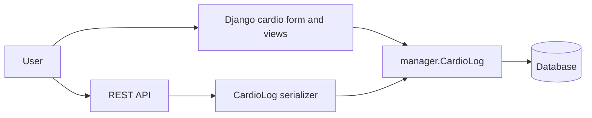

# Design: Standalone Cardio Logging

## Purpose and acceptance criteria

This feature addresses [wger issue #2510](https://github.com/wger-project/wger/issues/2510): cardio activities do not fit the current strength-set logging flow, which centers on repetitions and weight. A user should be able to record an activity such as a run, walk, hike, or rowing workout without first adding it to a strength routine.

The first version will let an authenticated user create, update, view, and delete a cardio entry with an activity name, date and time, optional duration in seconds, optional distance in meters/kilometers/miles, and optional notes. At least one of duration or distance is required; either may be zero, but negative values are rejected. Entries belong to their creator, and one user must not be able to read or modify another user's entry. The form and completed-entry view will be available in the web application, and the REST API will expose the same fields.

This version deliberately excludes interval/set breakdowns, heart-rate fields, calories-burned calculation, user-defined metrics, wearable/health-platform imports, and automatic nutrition-plan updates. Those require separate product and data-design decisions.

## Approaches considered

1. **Add cardio fields to `WorkoutLog` (rejected).** This reuses workout sessions and the existing API, but `WorkoutLog` represents an exercise set with repetitions and weight. Adding distance and duration there would put cardio-specific measurements on strength records and make both the model and its clients handle fields irrelevant to many logs.
2. **Store cardio metrics in flexible user-defined JSON fields (rejected).** This would make new metrics easy to add, but gives duration and distance inconsistent validation, querying, and API typing. It is not needed for this deliberately small first version.
3. **Add a dedicated `CardioLog` model (chosen).** A standalone record keeps cardio data explicit and queryable, and supports activity entries outside routines. It adds a migration and a small API/UI path, but avoids changing the meaning of existing workout logs.

For the web interface, a server-rendered Django form and list/detail page is chosen over changing the React application. This repository consumes `@wger-project/react-components` as an npm package; its React source is maintained separately. A Django page keeps the UI source, model, and API change reviewable in this repository and is consistent with wger's existing server-rendered tracking pages. The trade-off is that cardio logging will not initially use the React workout experience.

## Architecture and existing code

The feature belongs in the existing `wger/manager/` workout domain: a model and migration, a form and views/template, URL wiring, and an owner-scoped API serializer/viewset. The API and form will share model validation where practical. This follows wger's existing Django/Active Record style rather than introducing a new service or repository layer.

The change crosses the existing user-to-web/API boundary and adds stored personal activity data. The form and API must require authentication, derive ownership from the authenticated request, and scope reads and updates to that owner. Distance and duration must be validated on both write paths; clients must not be able to submit a different owner. Existing API behavior remains unchanged because the new endpoint is additive.

The database migration adds a new table, so existing workout-log data does not need backfilling or reinterpretation. Existing callers and clients remain compatible. PowerSync/mobile synchronization is deliberately out of scope; the first version supports the web flow and REST API only. Tests will cover model/form validation (including missing metrics, zero, and negative values), API create/update and cross-owner access, and an end-to-end web submission and display.

## Design principles

The dedicated model applies **High Cohesion** by keeping cardio-specific state together, and **Low Coupling** by leaving `WorkoutLog`'s strength-set semantics intact. Owner-scoped API access and server-side form validation provide **Protected Variations** at the web and API boundaries. A separate application service is deliberately avoided unless the implemented workflows reveal shared behavior that belongs outside the model and views.

## Project process

The project pull-request template asks contributors to discuss proposed features first and requires tests and formatting. Issue #2510 is the existing feature request; this coursework implementation will stay on the fork and will not open a duplicate pull request.
