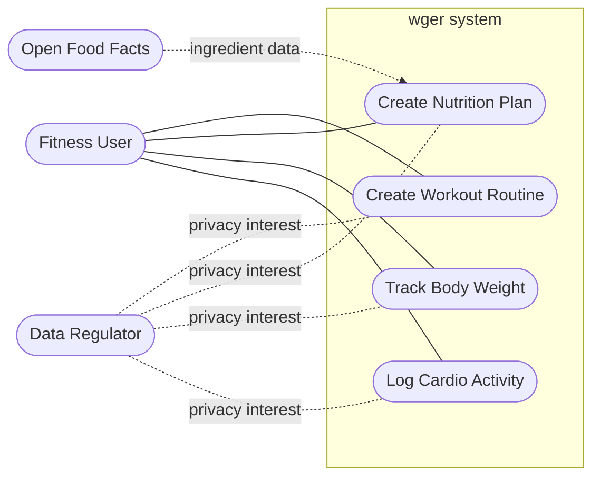
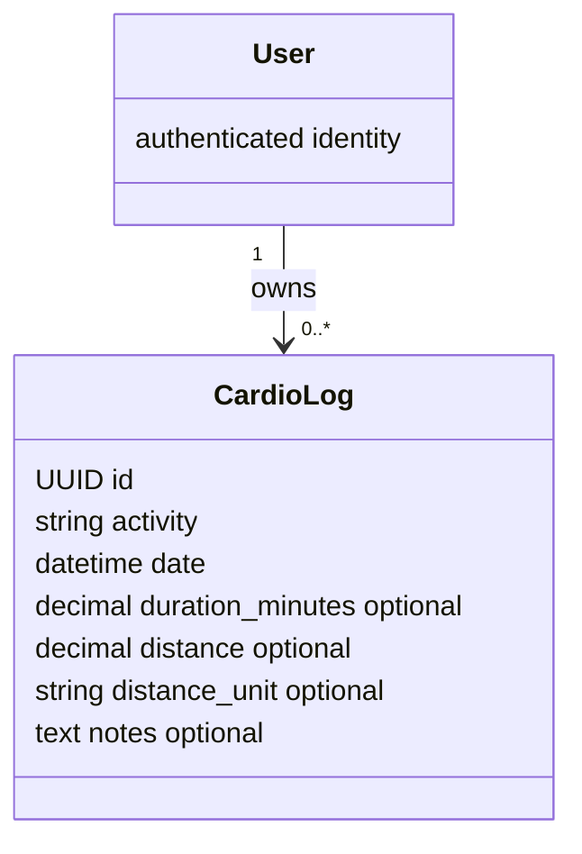
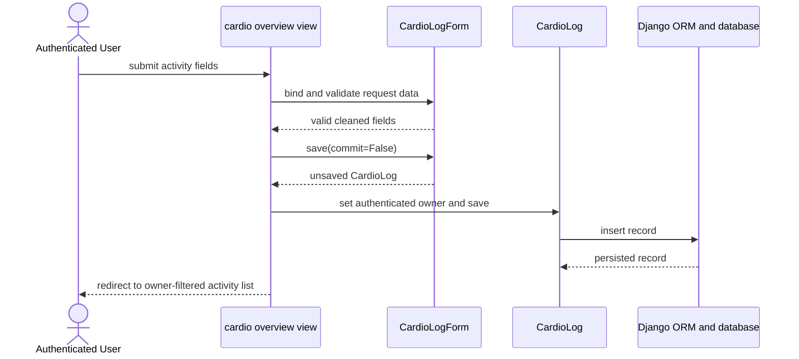
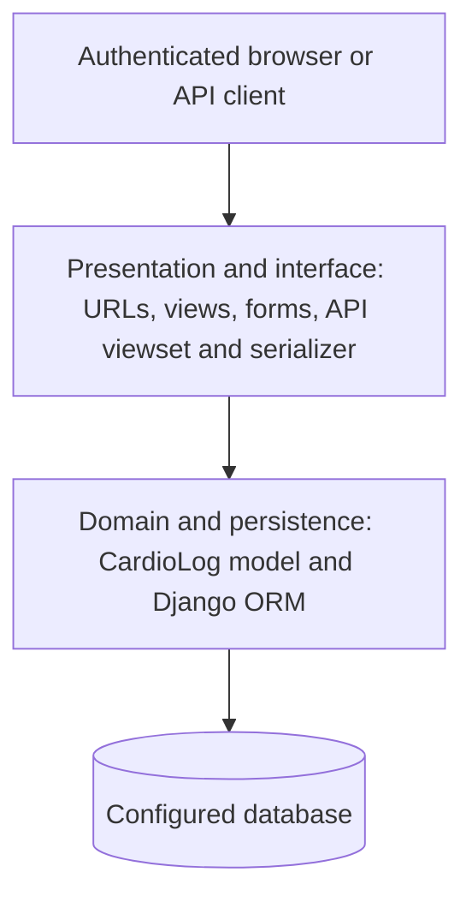
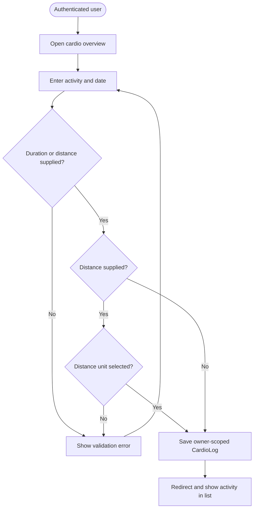
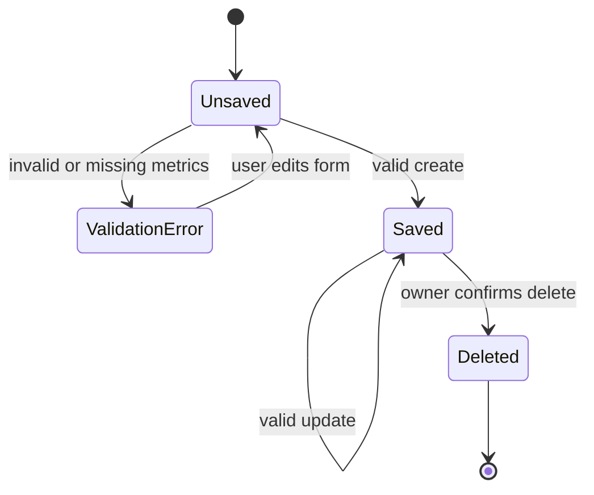

# Final Project: Software Architecture Document

**Status:** Draft for course review  
**Project:** wger Workout Manager  
**Feature:** Standalone cardio activity logging  
**Branch:** `feature/cardio-logging`  
**Implementation commit:** `23959c897`  
**Date:** 2026-11-23

## 1. Introduction

wger is a free and open-source fitness, workout, and nutrition manager. It supports people who plan exercise, record workouts and body measurements, and manage food and nutrition data. The repository contains a Django web application and REST API, a React frontend distributed as a separate package, and integrations and background tasks. This document records the architecture and design decisions for the final-project feature, standalone cardio activity logging, and summarizes the semester's design, security, and testing evidence. It is a course analysis of this repository and fork, not a statement that upstream maintainers have accepted the feature.

The feature responds to [wger issue #2510](https://github.com/wger-project/wger/issues/2510), which describes the mismatch between cardio activities and a strength log centered on repetitions and weight. An authenticated user can record, view, update, and delete a completed standalone activity. A record has an activity name, date and time, optional duration in minutes, optional distance in meters/kilometers/miles, and optional notes. At least one of duration or distance is required; zero is allowed and negative values are rejected. Records are private to their owner through both the web interface and REST API.

The first version does not add heart rate, intervals, calories burned, wearable imports, user-defined measurements, nutrition-plan updates, or synchronization with PowerSync/mobile clients. It logs completed activities independently of a planned weekly routine. Those exclusions keep the new record distinct from `WorkoutLog`, whose existing meaning is a completed strength-exercise set.

## 2. Use Case View

The existing use cases remain **Create Workout Routine**, **Create Nutrition Plan**, and **Track Body Weight**. The final feature adds **Log Cardio Activity**. The source diagram is [docs/use-case-diagram.puml](use-case-diagram.puml); the Mermaid rendering below shows the updated view.



### Refined use case: Log Cardio Activity

**Primary actor:** Authenticated fitness user. **Goal:** keep a personal record of a completed cardio activity without misrepresenting it as a strength set or requiring it to be scheduled in a routine. **Preconditions:** the user is authenticated and the cardio logging page is available. **Main success scenario:** the user enters an activity and date, supplies duration, distance, or both, selects a distance unit when entering distance, and submits the form. The web view validates the submitted form, assigns the authenticated user as owner, saves the `CardioLog`, and redirects to the overview, whose owner-filtered list displays the new record. The implementation is in `wger/manager/views/cardio.py`, `wger/manager/forms.py`, `wger/manager/models/cardio.py`, the cardio templates, and the URL configuration. The REST equivalent is `/api/v2/cardioactivity/`, routed in `wger/urls.py` to `CardioLogViewSet`.

Alternate outcomes include invalid or missing measurements (the form or serializer returns validation errors without saving), an unauthenticated request (login/authentication is required), and a request for a record owned by somebody else (the web view does not find it in the current user's queryset; the API queryset is owner-filtered). The create, update, delete, validation, and privacy cases are covered in `wger/manager/tests/test_cardio_log.py` and `wger/manager/tests/test_cardio_api.py`.

## 3. Logical View

The updated domain model is in [docs/domain-model.md](domain-model.md). It adds `CardioLog` and an ownership relationship to `Person` at the conceptual level; the Django implementation associates the record with `django.contrib.auth.models.User`. Its durable fields are `activity`, `date`, `duration_minutes`, `distance`, `distance_unit`, and `notes`, with a UUID identity. The model's `clean()` method and database check constraints require at least one measurement, require a unit when distance is present, reject a unit without distance, and reject negative duration or distance.

The design-level class view is:



The feature interaction path follows the web form submission:



The API path uses `CardioLogViewSet` and `CardioLogSerializer`; it validates model rules and scopes the queryset to the authenticated user. The UI is server-rendered and does not call the React package. The full feature interaction diagram is also in [docs/interaction-diagrams.md](interaction-diagrams.md).

## 4. Architectural View

wger is best described as a **hybrid, Django-centered architecture**, not a strictly layered system. URL modules dispatch to server-rendered views or REST viewsets; serializers and forms validate/map input; Django models combine domain data and persistence (Active Record); Celery tasks and signals create event-driven/background paths; integrations in packages such as `wger/nutrition/` communicate with external services. `docs/logical-architecture.md` shows the dependencies and the cardio feature's placement.

The cardio request path follows this dependency direction:



For cardio logging, the web route calls `wger/manager/views/cardio.py`, which uses `CardioLogForm` and the `CardioLog` model directly. API routing in `wger/urls.py` reaches `CardioLogViewSet`, which uses `CardioLogSerializer` and the same model. The model is persisted in the configured database. Dependencies therefore point from request-facing code toward the model and ORM, but the architecture is not a uniform one-way set of textbook layers: many existing views access models directly. The feature follows this local convention instead of adding a service/repository layer used nowhere else in the path.

### Project rules followed

The [contribution guide](https://wger.readthedocs.io/en/latest/contributing.html) says, “Before starting working on a new feature, please open an issue to discuss it with us,” asks contributors to add tests, format Python with `ruff format` and `ruff check --fix`, and asks them to consider UI/UX. The repository's `.github/pull_request_template.md` asks for tests for feature changes, formatting, and a `CHANGELOG.md` entry for substantial work. This work followed the existing issue `#2510`, used the feature branch `feature/cardio-logging`, added tests and a changelog entry, and ran Ruff on the changed feature files. The checked contribution materials did not specify a required commit prefix, DCO sign-off, or CLA; the course-specific A7/A8/A9 prefixes were used for course work, while the cardio implementation has a descriptive commit message. No upstream pull request was opened.

## 5. GRASP Analysis

The `CardioLog` model is a cohesive home for cardio-specific fields and invariants; this applies **High Cohesion** and protects `WorkoutLog` from acquiring fields unrelated to strength sets. `CardioLogSerializer` and the model share validation rather than duplicating the duration/distance rules. `CardioLogViewSet.get_queryset()` and the web views filter records by `request.user`, placing owner scoping at the request boundary. The A8 refactor also applied **Information Expert** by moving routine-derived calculations into `WorkoutRoutine` (`wger/manager/models/routine.py`) rather than leaving serializer code to calculate from model data; see commit `a918f8385` and the changes in `wger/manager/api/serializers.py`.

The architecture still has a **Low Coupling** concern: request-facing views commonly query or save Active Record models directly. For this new feature, the view in `wger/manager/views/cardio.py` both coordinates the request and persists the model. That is consistent with nearby Django code and is small, but a later workflow with shared web/API business rules could justify extracting a domain operation or application service. Adding such a layer now would be premature because the current form/API rules already converge on model validation.

## 6. Design Patterns

The clearest verified GoF pattern applied during the course is **Strategy** in `wger/exercises/deletion_strategies.py`. `DeletionStrategy` defines a common operation, and `ExerciseDeletionStrategy`, `TranslationDeletionStrategy`, `ImageDeletionStrategy`, and `VideoDeletionStrategy` encapsulate model-specific deletion behavior selected by `deletion_strategy_for()`. The change replaces the long model-type conditional in `wger/exercises/sync.py`; adding a new deletion type now means implementing/registering a strategy instead of expanding that central conditional. This is recorded in commit `9fb79a245` and tested in `wger/exercises/tests/test_sync.py`.

The final feature itself deliberately does not introduce a GoF pattern or an extra façade. Its small Django flow is covered by existing model/form/view conventions. A named Facade from the earlier pattern-identification exercise is not recorded with class-level evidence in this repository's current docs, so this draft does not make an unverified claim about its role.

## 7. Security Analysis

### Assets, misuse cases, and trust boundaries

The main protected asset introduced by the feature is a user's cardio activity history, including dates, duration, distance, and notes. `CardioLog` is private data: authenticated users may access their own entries, while other users must not read or change them. The relevant attacker goals from the semester's misuse-case work are bypassing authentication, reading another user's data, and changing another user's records. The user/browser to Django ingress, the unauthenticated-to-authenticated request path, and the application-to-database path are separate trust crossings. The numbered crossings and controls are documented in [docs/trust-boundary-diagram.md](trust-boundary-diagram.md).

For cardio, `@login_required` protects the web views; each web object lookup includes `user=request.user`. The API viewset's `get_queryset()` similarly returns only `CardioLog` rows owned by the request user, and `perform_create()` assigns the owner from the authenticated request rather than trusting a submitted user ID. Serializer/model validation and database check constraints enforce measurement invariants. These controls mitigate spoofing/elevation of privilege and information disclosure risks at the user-to-application boundary and protect record integrity at the persistence boundary. The API tests verify cross-user access returns 404 and exercise create/update/delete validation.

An earlier trust-boundary finding exposed a server-side request risk in nutrition image synchronization: the worker fetched a URL supplied in upstream API data. Commit `159805017` added `_is_trusted_wger_image_url()` in `wger/nutrition/sync.py`, restricts the image URL to the configured wger origin, and disables redirects on the image fetch. Tests in `wger/nutrition/tests/test_sync.py` verify an untrusted image URL is not fetched. This is a narrow control for that image-fetch path; it does not prove every outbound HTTP request elsewhere is safe. The trust-boundary artifact has been updated to show both the mitigation and its remaining limits.

### Supply chain and integrity

The checked-in CycloneDX file `docs/sbom.json` contains **342 components**. It was generated as the course SBOM artifact. This checkout does not contain a saved OSV/advisory scan result or a CVE/GHSA citation, so this draft deliberately does not invent a vulnerable dependency, affected range, or reachability path; restore the advisory and scan output from the earlier security assignment before submission if those findings are required. No release signing or build-attestation step was found in the checked `.github/workflows/` files. The SBOM supports component inventory, but the inspected workflows do not give a downloaded release artifact verifiable provenance back to a source commit. This is relevant to OWASP A06 (Vulnerable and Outdated Components) and A08 (Software and Data Integrity Failures).

The implemented URL-origin validation also relates to SSRF risk, but it does not substitute for dependency scanning or signed build provenance. A reasonable next supply-chain improvement is to publish SLSA-style provenance/attestations for release artifacts and verify them in release automation. That adds workflow maintenance, signing identity configuration, and release troubleshooting, but would let users verify source-to-artifact claims.

## 8. Global and Cultural Impact

wger's audience is not limited to one country or language: `settings/settings_global.py` defines available UI languages, and this checkout has 37 Django `.po` catalogs under `wger/locale/`. `LocaleMiddleware`, `USE_I18N`, `USE_TZ`, and the language cookie support locale-aware requests, while the global default language is English and the global timezone is UTC. The project also integrates Open Food Facts and documents a contributor community across its backend, frontend, mobile, Docker, and documentation repositories ([contributors](https://wger.readthedocs.io/en/latest/contributors.html)). These artifacts are evidence of internationalization and multiple deployment contexts; they do not establish that every translation or every deployment is complete.

The design makes several assumptions. First, the cardio form assumes text labels and validation messages can be localized through Django's translation system; the templates wrap labels in ``, but the checked locale catalogs do not yet contain these new cardio strings, so non-English users may see English fallback text. Second, it assumes a user has a usable authenticated account and a browser/API connection; a user without reliable connectivity cannot submit a log, and this feature has no offline/mobile synchronization. Third, the model stores a timestamp and the server uses timezone-aware Django settings, but users may interpret a workout's local date/time differently if the display timezone is not what they expect. Fourth, server-rendered semantic headings/table headers and `aria-labelledby` provide basic structure, but the repository does not include an accessibility audit for this new page; keyboard, screen-reader, contrast, and zoom behavior still need manual verification.

One group likely served less well by this feature is users who depend on a non-English interface: the project has broad locale infrastructure, but this feature's new strings have not been added to translations. The assumption is located in the templates and locale catalogs, so the architecture makes a fix feasible: extract/update translation catalogs and send the messages through the project's translation process. Maintainers would need to translate and review strings, including pluralization/context, and keep catalogs synchronized as labels change. Users with intermittent connectivity are also excluded from the current web-only entry workflow; supporting them would require deliberate mobile/PowerSync schema and conflict behavior rather than simply exposing the current API.

Because wger can be self-hosted or used by people in different jurisdictions, personal workout records may fall under privacy and data-protection rules depending on the operator, users, and use context. For example, GDPR Article 9 addresses processing of data concerning health; whether a particular workout record is legally such data and which obligations apply depends on context and jurisdiction. The feature therefore keeps entries owner-scoped and does not infer medical conclusions. This is an architectural risk discussion, not legal advice ([official GDPR text, Article 9](https://eur-lex.europa.eu/eli/reg/2016/679/oj)).

## 9. Testing and Test History

The feature has unit-level model validation tests and system-level web/API tests. Model tests cover duration-only, distance-only, both metrics, zero, missing metrics, negative values, and database constraints. Web tests exercise the authenticated create, list, update, delete, invalid submission, and owner privacy flows. API tests exercise create/read, update, delete, invalid negative values, and isolation from another user's records. The browser-style web test caught and pinned a concrete UI regression: nested crispy-form markup had placed the submit button outside the actual form; the template/form helper was corrected and the test now checks the single form structure.

The full test suite was run after the feature implementation with:

```bash
DJANGO_SETTINGS_MODULE=settings.ci ./.venv/bin/python manage.py test --verbosity 1
```

It reported **2,282 tests run, OK (skipped=36)** in 177.079 seconds. Ruff checks passed for the changed feature files, and `makemigrations manager --check --dry-run` reported no model/migration drift. This is a passing code-level verification; the test suite does not establish usability or screen-reader accessibility.

The earlier coverage artifact (`docs/coverage-report.md`) reports **91% line coverage** from Coverage.py. It is a baseline from before this feature and records a prior network/DNS error in one test, so it should not be represented as the final feature's coverage or as a clean whole-suite result. Line coverage records execution, not assertion quality; the report itself warns that limitation. The final cardio feature has tests at model, web, and API levels, but no updated coverage report is committed.

The A7 TDD evidence in repository history includes characterization tests in commit `23f3b7b0d`, a failing missing-profile test in `7f7507435`, and the fix in `b6f3df3be`. A separate A7 refactor commit is not present in the inspected history; the course write-up should say no refactor was warranted only if that matches what happened. Earlier characterization work targeted registration permissions, exercise scheduling, and USDA import behavior because these paths affect account access, routine behavior, and imported nutrition data. The test history showed that Django fixtures and existing integration behavior make database-backed paths less isolated than ordinary pure functions.

The main defect found during the A7 cycle was that an API permission path could behave incorrectly when the user profile was missing. The failing test exposed the edge case; the small fix in `wger/core/api/permissions.py` denies registration when the profile is absent. The current cardio feature learned from those testing constraints by covering both the data rules and requests through Django's clients rather than relying only on isolated helper tests.

### Self-review of the feature diff

Reading the feature diff led to three concrete refinements: database check constraints were added alongside field/form/API validation; `CardioLog.get_owner_object()` was added so wger's generic owner-permission path recognizes the new record; and a blank date in the create form was made to default to the current time. The most likely reviewer concern is the server-rendered page instead of a React screen, followed by whether `duration_minutes` is the right public API unit. The feature keeps the first version in this repository and leaves the API naming decision open for review; the trade-off is that it does not yet join the React workout experience.

## 10. Activity and State Views

The repository did not contain a standalone Week 12 activity/state diagram to update. The diagrams below are derived from the implemented cardio code and should be reconciled with the course's original Week 12 artifact if that is required for grading.





## 11. Architecture Decision Records

### ADR-1: Store cardio activities as standalone `CardioLog` records

**Status:** Accepted and implemented  
**Date:** 2026-11-23

**Context:** Strength logs model repetitions and weight, but cardio activities need time and distance, and the upstream request describes logging them outside a routine. The feature adds personal activity data and a public API resource.

**Decision:** Add a dedicated `CardioLog` model in `wger/manager/models/cardio.py`, a migration, an authenticated web flow, and an owner-scoped REST resource. Keep distance/duration typed, validate at model/API/form/database layers where appropriate, and keep the entries independent of planned routines for this first version.

**Alternatives considered:** Adding cardio fields to `WorkoutLog` was rejected because it would mix two different record semantics and burden strength-log clients with irrelevant values. A user-defined JSON field was rejected because it weakens validation, querying, and API typing. React-based UI work was deferred because this repository consumes React components from a separately maintained package; a Django server-rendered form keeps this first implementation reviewable alongside the model and tests.

**Consequences:** Existing workout records and callers remain unchanged; the new table and endpoint are additive. The dedicated data model is easier to query and validate, but duplicates some endpoint/form wiring and does not yet sync to mobile/PowerSync or fit the React workout flow. The public API unit `duration_minutes` and keeping distance units per entry are review questions retained in `docs/PR.md`.

### ADR-2: Follow the existing Django Active Record request path

**Status:** Accepted for this feature  
**Date:** 2026-11-23

**Context:** wger is a large Django application with models, forms, serializers, views, and background tasks. Its request-facing code often accesses Django models directly, and the cardio workflow is currently small.

**Decision:** Use the existing `wger/manager/` model/form/view/serializer/URL conventions and validate core measurement rules on `CardioLog`; do not introduce a one-off service or repository layer for this feature.

**Alternatives considered:** A new service/repository could centralize web and API orchestration, but it would create an isolated architectural pattern for one small workflow while the model already owns the invariant. Extending React would align the experience with newer screens, but the React source is a separate package and would add cross-repository build/release work.

**Consequences:** The feature is consistent with nearby code and limited to this fork's Django changes. The view has direct model coupling, and future shared workflows or domain operations may justify a service boundary. This decision does not claim that direct Active Record access is ideal for every part of wger.

## 12. Conclusion and Next Iteration

The feature adds a distinct, owner-scoped cardio record without changing the meaning of strength logs. The design choice that mattered most was whether cardio should be attached to a routine, folded into `WorkoutLog`, or modeled separately. The dedicated record was chosen because the feature request describes completed cardio as its own tracking entry and the code's existing strength model has different measurements. A next iteration should add translation catalog entries and accessibility review, decide whether mobile sync and the React interface should support the record, and ask maintainers whether the API field names and units match their expectations before an upstream contribution.

AI assistance helped organize repository evidence, draft diagrams and prose, and cross-check code paths against the current implementation. It can still overstate what a test proves or turn a course document into an unsupported project claim; therefore commit IDs, behavior, translations, dependency advisories, and legal conclusions must be verified against their original sources before submission. The separate [AI Use Log](AI-Use-Log.md) records the assistant's role. The résumé deliverable is intentionally omitted for later, as requested.
