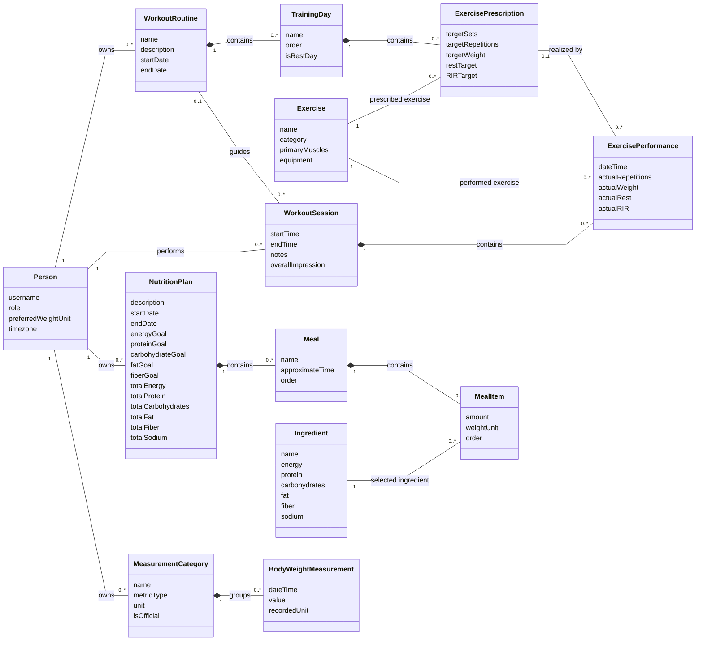

# Domain Model

## Noun-Phrase Analysis

| Noun phrase | Found in | Decision | Why |
| --- | --- | --- | --- |
| fitness user / registered user | All three use cases, Primary Actor and Preconditions | Conceptual class: `Person` | A real person with an identity who owns plans and measurements. |
| trainer | Create Workout Routine, Stakeholders and Special Requirements | Conceptual class: `Person` role | A trainer is another person participating in the fitness domain, represented by the role of a `Person`. |
| system owner | All three use cases, Stakeholders | Neither | An external stakeholder; the use cases do not require the system to store information about this actor. |
| workout routine / workout schedule / completed schedule | Create Workout Routine, steps 1-8 | Conceptual class: `WorkoutRoutine` | A persistent plan with its own identity, dates, days, and exercises. |
| routine name | Create Workout Routine, step 3 | Attribute of `WorkoutRoutine` | Text that describes a routine. |
| routine description / training goal | Create Workout Routine, Stakeholders and step 3 | Attribute of `WorkoutRoutine` | Text describing the routine's purpose. |
| start date / end date | Create Workout Routine, steps 3 and 5 | Attributes of `WorkoutRoutine` | Dates that define the routine's active period. |
| training day | Create Workout Routine, step 6 | Conceptual class: `TrainingDay` | A persistent part of a routine that groups prescribed exercises. |
| exercise | Create Workout Routine, Stakeholders and step 7 | Conceptual class: `Exercise` | A recognized physical activity that can occur in many routines. |
| exercise parameters / progression settings | Create Workout Routine, Stakeholders and step 7 | Conceptual class: `ExercisePrescription` | They describe how an exercise is prescribed for a particular routine day and may change independently over time. |
| sets / repetitions / target weight / rest | Create Workout Routine, step 7 | Attributes of `ExercisePrescription` | Numeric values that describe one exercise prescription. |
| workout history | Create Workout Routine, Special Requirements | Neither | A collection of workout sessions and performances, not a separate domain object. |
| Add Routine screen / routine form | Create Workout Routine, Preconditions and step 2 | Neither | User-interface elements, not domain concepts. |
| maximum routine duration / date range | Create Workout Routine, Extensions 3a-3b | Neither | Validation rules over the routine's start and end date attributes. |
| user account | Create Workout Routine, step 5 | Neither | A software/authentication representation of a `Person`, not a separate fitness-domain concept. |
| owner / authorized trainer | Create Workout Routine, Special Requirements | Neither | Roles in associations between a `Person` and a routine, not separate things. |
| nutrition plan | Create Nutrition Plan, steps 1-9 | Conceptual class: `NutritionPlan` | A persistent plan with meals, goals, and calculated nutrition. |
| plan description | Create Nutrition Plan, step 3 | Attribute of `NutritionPlan` | Text describing the plan's purpose. |
| plan dates | Create Nutrition Plan, step 3 | Attributes of `NutritionPlan` | Dates defining when the plan applies. |
| nutritional goals | Create Nutrition Plan, step 3 | Attributes of `NutritionPlan` | Numeric targets for energy and nutrients. |
| meal | Create Nutrition Plan, steps 5-8 | Conceptual class: `Meal` | A distinct scheduled grouping of foods in a nutrition plan. |
| meal name / approximate time | Create Nutrition Plan, step 5 | Attributes of `Meal` | Text and time values describing a meal. |
| ingredient | Create Nutrition Plan, Preconditions and steps 7-8 | Conceptual class: `Ingredient` | A reusable food item with nutritional information. |
| meal item | Create Nutrition Plan, steps 7-8 | Conceptual class: `MealItem` | The association between a meal and an ingredient, carrying quantity and unit. |
| ingredient quantity / amount | Create Nutrition Plan, step 7 and Extension 7a | Attribute of `MealItem` | A numeric value describing how much of an ingredient is used. |
| weight unit | Create Nutrition Plan, step 7 | Attribute of `MealItem` | A value describing how the ingredient amount is measured. |
| energy / protein / carbohydrate / fat / fiber / sodium totals | Create Nutrition Plan, step 8 | Derived attributes of `NutritionPlan` | Numeric totals calculated from the plan's meal items. |
| food database | Create Nutrition Plan, Preconditions | Neither | A storage or external-system mechanism rather than a fitness-domain concept. |
| nutrition plan overview / nutrition plan form | Create Nutrition Plan, steps 1-2 | Neither | User-interface elements. |
| plan reference / plan field | Create Nutrition Plan, Extension 5a | Neither | API and form implementation details referring to a `NutritionPlan`. |
| validation error | Create Nutrition Plan, Extensions 5a and 7a | Neither | A system response, not a persistent domain concept. |
| body-weight measurement / weight entry | Track Body Weight, Success Guarantee and steps 3-7 | Conceptual class: `BodyWeightMeasurement` | A dated fact with its own value and identity. |
| measurement date | Track Body Weight, steps 3-4 | Attribute of `BodyWeightMeasurement` | A date and time describing when the measurement was taken. |
| weight value | Track Body Weight, steps 3-6 | Attribute of `BodyWeightMeasurement` | A numeric value recorded by the user. |
| recorded unit | Track Body Weight, steps 5-6 | Attribute of `BodyWeightMeasurement` | The unit in which that particular value was entered. |
| body-weight category / official category | Track Body Weight, Success Guarantee and Extension 6a | Conceptual class: `MeasurementCategory` | A persistent classification that groups a person's body-weight measurements. |
| preferred weight unit | Track Body Weight, Preconditions and steps 2-6 | Attribute of `Person` | A stored preference such as kilograms or pounds. |
| weight history / previous measurements | Track Body Weight, Stakeholders and steps 2 and 7 | Neither | A collection of `BodyWeightMeasurement` objects. |
| chronological order | Track Body Weight, step 2 | Neither | A presentation rule for a collection of measurements. |
| permitted range / allowed range | Track Body Weight, Extension 3a | Neither | A validation rule applied to a weight value and unit. |
| Weight Overview screen | Track Body Weight, steps 1-2 | Neither | A user-interface element. |

## Updated Model

## What Changed

The previous model focused only on workout planning and logging. The updated model renames `TrainingPlan` to `WorkoutRoutine` to match the use-case vocabulary, adds `TrainingDay` between a routine and its exercise prescriptions, and adds the nutrition and body-weight concepts required by the other two use cases. Values such as dates, quantities, nutrient totals, and units are modeled as attributes, while screens, forms, errors, histories, and validation rules are excluded because they are interface, software, collection, or policy concepts rather than conceptual classes.
