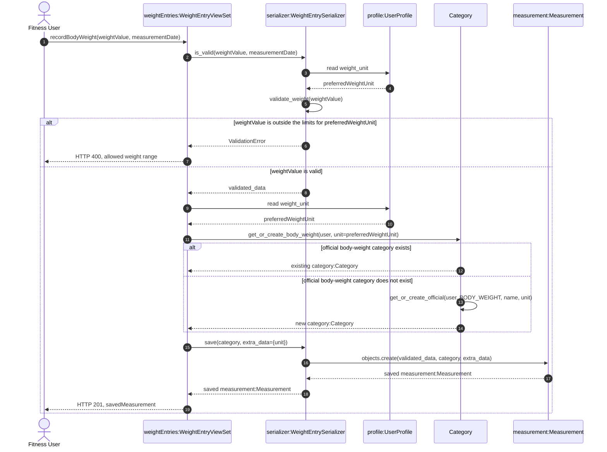
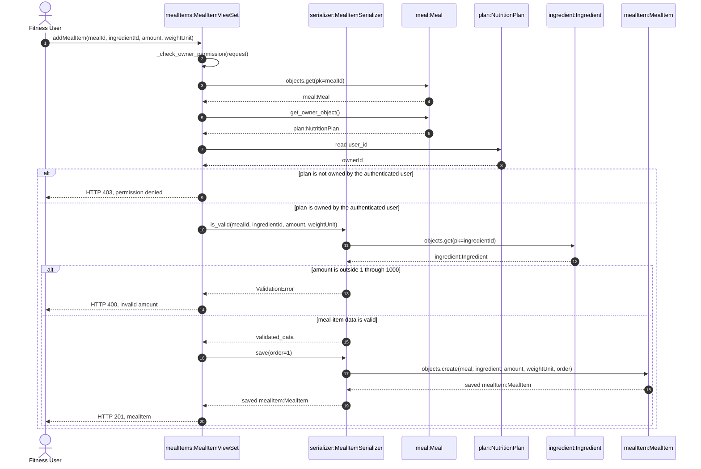

# Interaction Diagrams

## Record Body Weight

This diagram expands the SSD event `recordBodyWeight(weightValue, measurementDate)`.



Participants are implemented by `WeightEntryViewSet` in `wger/weight/api/views.py`, `WeightEntrySerializer` in `wger/weight/api/serializers.py`, `UserProfile` in `wger/core/models/profile.py`, and `Category` and `Measurement` in `wger/measurements/models/`.

## Add Meal Item

This diagram expands the SSD event `addMealItem(mealId, ingredientId, amount, weightUnit)`.



Participants are implemented by `MealItemViewSet` in `wger/nutrition/api/views.py`, `MealItemSerializer` in `wger/nutrition/api/serializers.py`, and `Meal`, `NutritionPlan`, `Ingredient`, and `MealItem` in `wger/nutrition/models/`.

## Log Cardio Activity

This diagram follows the successful web form submission from the final-project feature. The view is a Django function rather than a controller class; `CardioLogForm` validates the submitted model fields and the view assigns the authenticated owner before saving.

```mermaid
sequenceDiagram
    autonumber
    actor User as Authenticated User
    participant V as overview (wger/manager/views/cardio.py)
    participant F as CardioLogForm
    participant M as CardioLog
    participant DB as Django ORM / database

    User->>V: POST activity, date, duration, distance, unit, notes
    V->>F: bind request.POST
    V->>F: is_valid()
    F-->>V: valid form and cleaned model fields
    V->>F: save(commit=False)
    F-->>V: unsaved CardioLog instance
    V->>M: assign user=request.user
    V->>M: save()
    M->>DB: INSERT CardioLog row
    DB-->>M: persisted row
    M-->>V: saved activity
    V-->>User: redirect to cardio overview; activity appears in owner-filtered list
```

The main success path is implemented in `wger/manager/views/cardio.py`, `wger/manager/forms.py`, `wger/manager/models/cardio.py`, and `wger/manager/templates/manager/cardio/overview.html`. Model validation is shared with the API serializer in `wger/manager/api/serializers.py`.
