# Logical Architecture

```mermaid
flowchart TB
    subgraph presentation["Presentation and Interface Layer"]
        direction LR
        rootRoutes["wger/urls.py"]
        featureRoutes["wger/*/urls.py"]
        webViews["wger/*/views/"]
        reactHost["wger/core/views/react.py"]
        templates["wger/*/templates/"]
        apiViews["wger/*/api/views.py"]
        apiSupport["wger/*/api/serializers.py<br/>wger/*/api/filtersets.py<br/>wger/*/api/permissions.py"]
    end

    subgraph application["Application and Orchestration Layer"]
        direction LR
        services["wger/trophies/services/<br/>wger/measurements/dynamic/<br/>wger/manager/config_calculations/"]
        events["wger/*/signals.py"]
        jobs["wger/tasks.py<br/>wger/*/tasks.py"]
    end

    subgraph domain["Domain and Persistence Layer (Django Active Record)"]
        direction LR
        coreModels["wger/core/models/"]
        workoutModels["wger/manager/models/<br/>wger/exercises/models/"]
        nutritionModels["wger/nutrition/models/"]
        trackingModels["wger/measurements/models/"]
        otherModels["wger/config/models/<br/>wger/gallery/models/<br/>wger/gym/models/<br/>wger/mailer/models/<br/>wger/trophies/models/"]
    end

    subgraph infrastructure["Shared Infrastructure and External Adapters"]
        direction LR
        utilities["wger/utils/"]
        integrations["wger/nutrition/sync.py<br/>wger/nutrition/extract_info/"]
        celery["wger/celery_configuration.py"]
        configuration["settings/"]
    end

    rootRoutes -->|includes| featureRoutes
    rootRoutes -->|registers REST endpoints| apiViews
    featureRoutes -->|dispatches requests| webViews
    featureRoutes -->|dispatches React pages| reactHost
    webViews -.->|renders| templates
    reactHost -.->|renders| templates
    apiViews -->|uses| apiSupport

    webViews -->|calls| services
    apiViews -->|calls| services
    webViews -->|accesses directly| coreModels
    webViews -->|accesses directly| workoutModels
    webViews -->|accesses directly| nutritionModels
    webViews -->|accesses directly| trackingModels
    webViews -->|accesses directly| otherModels
    apiViews -->|accesses directly| coreModels
    apiViews -->|accesses directly| workoutModels
    apiViews -->|accesses directly| nutritionModels
    apiViews -->|accesses directly| trackingModels
    apiViews -->|accesses directly| otherModels
    apiSupport -->|maps and validates| coreModels
    apiSupport -->|maps and validates| workoutModels
    apiSupport -->|maps and validates| nutritionModels
    apiSupport -->|maps and validates| trackingModels

    services -->|uses| coreModels
    services -->|uses| workoutModels
    services -->|uses| trackingModels
    services -->|uses| otherModels
    events -->|observes changes| coreModels
    events -->|observes changes| workoutModels
    events -->|observes changes| nutritionModels
    events -->|observes changes| trackingModels
    events -->|observes changes| otherModels
    events -->|enqueues| jobs

    jobs -->|uses| coreModels
    jobs -->|uses| trackingModels
    jobs -->|calls| integrations
    jobs -->|registered with| celery
    celery -->|reads| configuration
    apiViews -->|reads| configuration
    services -->|uses| utilities
    events -->|uses| utilities
    coreModels -->|uses| utilities
    workoutModels -->|uses| utilities
    nutritionModels -->|uses| utilities
    trackingModels -->|uses| utilities
```

Arrows point from the package that depends on or calls another package toward the dependency. Dashed arrows represent template rendering. The direct arrows from web and API views to model packages show that wger is not strictly layered: its Django views and REST viewsets frequently use Active Record models without a separate repository or application-service layer. The `models/` packages therefore combine domain behavior and persistence, while signals and Celery tasks provide secondary event-driven and background-job paths.
