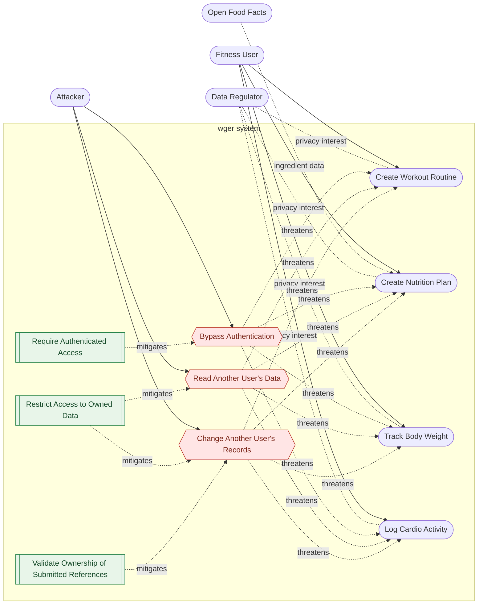

# Misuse Case Diagram

## Security Control Evidence

- **Require Authenticated Access:** the measurement endpoints require `IsAuthenticated`; `RoutinePermission` also rejects unauthenticated requests. See `wger/measurements/api/views.py` and `wger/manager/api/permissions.py`.
- **Restrict Access to Owned Data:** measurement queries are filtered by the requesting user, and `RoutinePermission` limits private routines and workout history to their owner. See `wger/measurements/api/views.py` and `wger/manager/api/permissions.py`.
- **Validate Ownership of Submitted References:** `WgerOwnerObjectModelViewSet` checks foreign-key ownership before create and update operations. See `wger/utils/viewsets.py`.
