# Trust Boundary Diagram

The numbered arrows mark data crossings. A number can represent traffic in both directions when the arrow is bidirectional; the findings table describes the validation at each crossing.

```mermaid
flowchart LR
    subgraph External["External and untrusted systems"]
        Client["Browser or mobile client"]
        Upstream["Configured upstream wger API"]
        OFF["Open Food Facts"]
        ImageHost["Image URL supplied by upstream"]
    end

    subgraph Web["wger web application process"]
        Ingress["Django and DRF request ingress"]
        Auth["DRF authentication and permissions"]
        Public["Public or unauthenticated handlers"]
        subgraph AuthenticatedPath["Authenticated API path (logical trust boundary)"]
            Protected["Authenticated API views and viewsets"]
            Serializers["DRF serializers"]
            Domain["Application logic and Django models"]
            Producer["Celery task producer"]
        end
    end

    subgraph BrokerZone["Task broker service"]
        Broker["Redis / Celery broker"]
    end

    subgraph WorkerZone["Background worker process"]
        Tasks["wger/*/tasks.py"]
        Integrations["wger/nutrition/sync.py and extractors"]
        WorkerORM["Django ORM"]
    end

    subgraph DataZone["Persistent data store"]
        Database[("PostgreSQL or configured database")]
    end

    Client <-->|"1. HTTP request and response"| Ingress
    Ingress --> Auth
    Auth -->|"2. identity verified before protected handling"| Protected
    Ingress --> Public
    Protected --> Serializers
    Serializers --> Domain
    Domain --> Producer

    Domain <-->|"3. SQL queries and returned rows"| Database
    Producer -->|"4. serialized task arguments"| Broker
    Broker -->|"5. queued task message"| Tasks
    Tasks --> Integrations
    Integrations <-->|"6. API request and response"| Upstream
    Integrations <-->|"7. product and image data"| OFF
    Integrations <-->|"8. fetch URL and image response"| ImageHost
    Tasks --> WorkerORM
    WorkerORM <-->|"9. SQL queries and returned rows"| Database

    classDef external fill:#fff4e5,stroke:#b54708,color:#7a2e0e
    classDef security fill:#e8f5e9,stroke:#27834a,color:#174b2a
    class Client,Upstream,OFF,ImageHost external
    class Auth security
```

## Crossing Findings

| # | Data crossing | What is validated, and by which component |
| --- | --- | --- |
| 1 | Client and web ingress: requests, credentials, and responses | DRF authentication classes validate supported session and token credentials. Endpoint serializers validate request fields after parsing. The repository does not establish that TLS is enabled at the deployment proxy, so transport encryption must be verified in deployment configuration. |
| 2 | Unauthenticated request path to authenticated API path | DRF authentication establishes the request identity; `IsAuthenticated` and `RoutinePermission` gate protected operations. Authentication does not make the request body trustworthy; serializers still validate it. |
| 3 | Web application and database | Django ORM constructs database operations; database field types, foreign keys, and constraints validate stored structure. Serializer and application rules validate many business constraints before writes, but the database does not enforce every business rule. |
| 4 | Web process and task broker | Celery serializes task arguments. The application does not validate each message at the broker boundary; broker access is trusted to deployment configuration and network restrictions. |
| 5 | Task broker and background worker | Celery deserializes and dispatches task messages. No application-level publisher identity check is visible at the task consumer; the worker relies on the broker being restricted to trusted publishers. |
| 6 | Background worker and configured upstream wger API | `requests` retrieves the API response. The ingredient sync extractor maps fields into `IngredientData` and runs sanity checks; malformed records are skipped by the sync loop. This validates imported values, but does not validate every URL contained in the response. |
| 7 | Background worker and Open Food Facts | The Open Food Facts client handles API access. Imported ingredient values pass through the ingredient extraction and sanity-check path; downloaded image content is checked by the image validator after retrieval. |
| 8 | Background worker and the image URL supplied by upstream data | **Finding:** `fetch_image_from_wger_instance()` passes `image_data['image']` directly to `requests.get()`. The code does not first restrict the scheme or host. `BaseImageMixin` validates the downloaded bytes as an image only after the request has already been made. |
| 9 | Background worker and database | Django ORM operations are subject to database schema constraints. Imported ingredient values are also normalized and sanity-checked in the integration layer before persistence. |

## Trust Finding

The image sync worker trusts the destination URL supplied in an upstream API response. If that upstream response is compromised or contains a malicious URL, the worker could make a server-side request to an internal address or service. The later image-format check can reject the returned bytes, but it cannot undo the request; the worker should validate the URL scheme and allowed host before fetching it.

## Code Evidence

- Authentication classes: `settings/settings_global.py`
- Protected measurement routes and owner-scoped querysets: `wger/measurements/api/views.py`
- Routine authentication and object permissions: `wger/manager/api/permissions.py`
- Celery broker settings: `settings/main.py`
- Worker tasks: `wger/nutrition/tasks.py`
- Upstream image URL fetch: `wger/nutrition/sync.py`, `fetch_image_from_wger_instance()`
- Image-byte validation after download: `wger/utils/helpers.py`, `BaseImageMixin.save_image()`

## Embed in the Wiki

Copy the Mermaid code block above into the wiki page. The table below it documents what is checked at each numbered crossing and the trust gap identified in the worker's image-fetch path.
